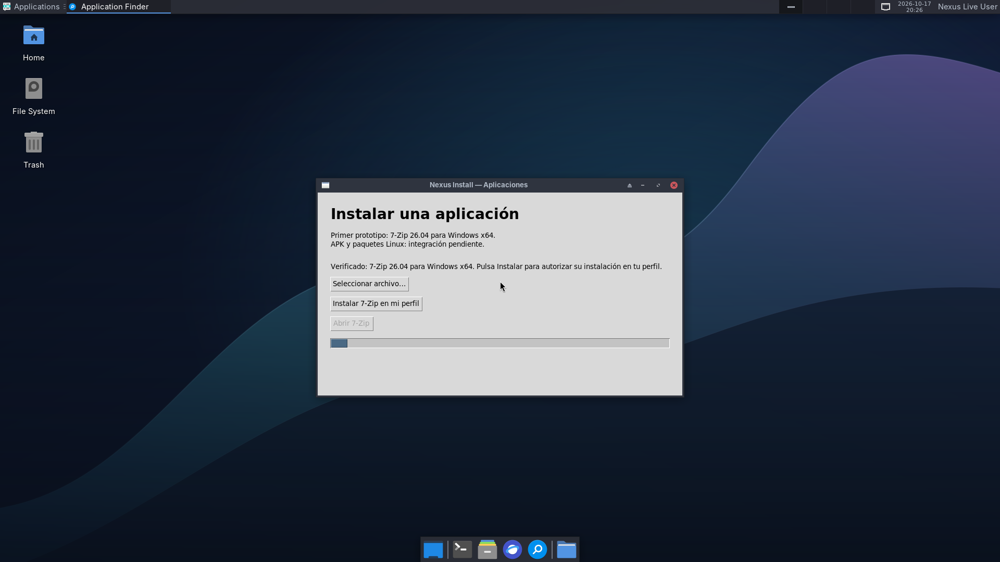
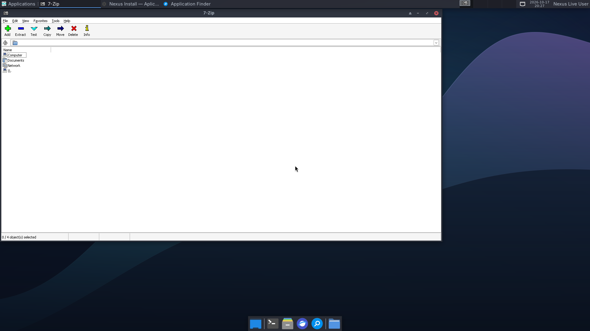

# 7-Zip dentro de Nexus Live

Prueba aprobada: https://github.com/CmdOS-system/Nexus-os/actions/runs/39066298801

ISO fuente791625cd; SHA256 eb480efef282fa109f1f5eb35d609aa77656f8b0269bff7485c444d02b544520.

Capturas sin retoques del framebuffer QEMU1920x1080. Confirmación automatizada del botón; no prueba de clic físico en Thunar ni persistencia tras reinicio. Instalador aprobado únicamente7-Zip26.04 x64. Reapertura posterior del asistente probada aparte en Wine Lab39066411933.
